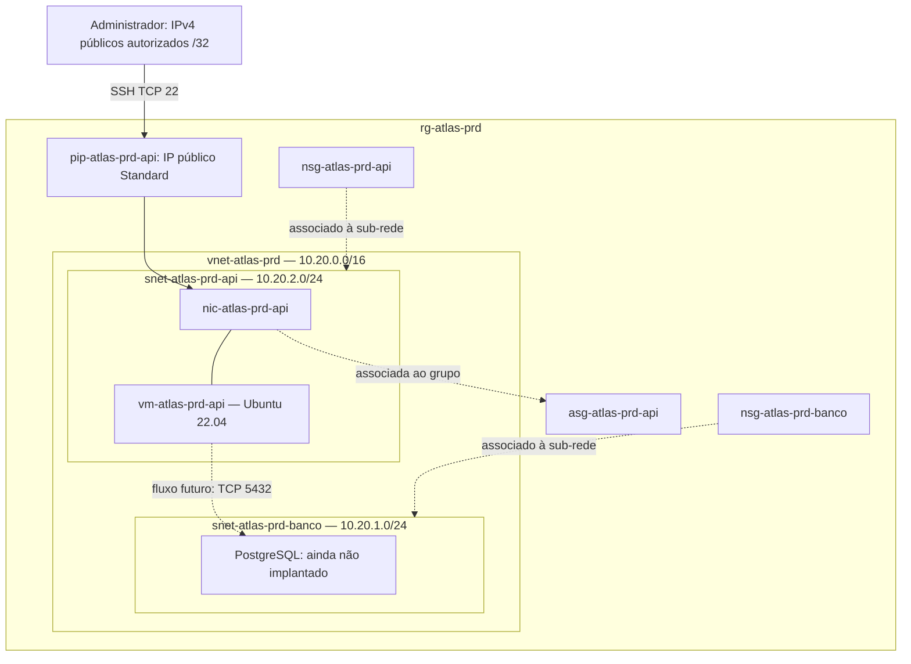

# Atlas — Infraestrutura Azure com Terraform

Laboratório de infraestrutura como código para praticar Azure, Linux, redes e fundamentos de operação de ambientes Cloud/SRE.

Esta documentação descreve a **base refatorada do PRD simulado**: uma VM Ubuntu com acesso SSH por chave, rede segmentada e regras de segurança. O código está organizado por responsabilidade, com nomenclatura `api` para os recursos da aplicação.

> Ambiente de estudo com cenário empresarial simulado. Esta versão não representa uma aplicação em produção nem implementa alta disponibilidade.

## Evolução e validação

- **Base DEV:** preservada na [tag v0.1.0](https://github.com/DevDanielAlbuquerque/atlas-terraform-azure/tree/v0.1.0), incluindo a documentação original.
- **Encerramento do DEV:** Terraform confirmou `17 destroyed` antes da criação do novo ambiente.
- **PRD simulado — 22/11/2026:** execução local concluiu `Apply complete! Resources: 17 added, 0 changed, 0 destroyed.` O acesso SSH à nova VM foi testado com sucesso pelo autor.
- **Refatoração:** `main.tf` foi distribuído entre arquivos de configuração, rede, segurança e computação. Os nomes passaram de `app` para `api`, e o ambiente padrão passou de `dev` para `prd`.
- **Backend remoto — 23/11/2026:** State migrado para Azure Blob Storage com autenticação Microsoft Entra ID, permissões RBAC, versionamento de blobs e bloqueio de State. Leitura dos 17 recursos validada no notebook; `terraform plan` final no desktop retornou `No changes`.
- **Segurança — 23/11/2026:** preservação da identidade gerenciada `SystemAssigned` da VM e suporte a múltiplas origens IPv4 `/32` para SSH.

- **Refatoração estrutural — 27/11/2026:** branch `refactor/atlas-structure`, separação dos diretórios Terraform e Ansible, reorganização dos arquivos, comentários simplificados e novas validações de entradas. O plano retornou `No changes`; a comparação do state foi concluída pelo autor, sem necessidade de novo apply.

O nome PRD representa uma simulação de estudo; não implica prontidão para produção. A tag preserva código e documentação, não discos, dados ou o estado da infraestrutura.

## Estado do projeto

| Entrega | Situação nesta versão |
|---|---|
| Grupo de recursos, VNet e duas sub-redes | Implementados |
| NSGs, regras e associações às sub-redes | Implementados |
| ASG da API e associação da NIC | Implementados |
| IP público Standard estático e NIC | Implementados |
| VM Ubuntu 22.04 LTS Gen2 com identidade gerenciada `SystemAssigned` | Implementada |
| Acesso SSH por chave e origens IPv4 `/32` autorizadas | Acesso inicial validado em 22/11; regra com múltiplas origens aplicada em 23/11 |
| Bloqueio de SSH por outra rede | Teste prático pendente |
| VM/serviço PostgreSQL e consulta ao banco | Ainda não implementados |
| Backend remoto Azure Blob Storage | Implementado e validado em 23/11/2026 |
| API C#, monitoramento e backups | Etapas futuras |

O estado acima registra o progresso do laboratório, não uma verificação em tempo real dos recursos na Azure.

## Arquitetura

Configuração padrão: projeto `atlas`, ambiente `prd`, região `eastus2`.



As linhas de associação representam configuração, não saltos do tráfego. A separação em sub-redes organiza os recursos; o controle de acesso é feito pelas regras dos NSGs.

### Regras implementadas

Todas as regras abaixo são de entrada, usam TCP e permitem qualquer porta de origem.

| NSG | Prioridade | Origem | Destino | Porta de destino | Ação |
|---|---:|---|---|---:|---|
| Aplicação | 100 | `ssh_allowed_cidrs` (lista IPv4 `/32`) | Sub-rede da aplicação | 22 | Allow |
| Aplicação | 200 | Qualquer origem | Sub-rede da aplicação | 22 | Deny |
| Banco | 100 | ASG da API | Sub-rede do banco | 5432 | Allow |
| Banco | 200 | Qualquer origem | Sub-rede do banco | 5432 | Deny |

A primeira regra correspondente decide a ação. Os bloqueios de prioridade 200 precedem a regra padrão `AllowVNetInBound` de prioridade 65000.

**O bloqueio é específico às portas indicadas.** Esta configuração não bloqueia todo o tráfego entre sub-redes. As demais regras padrão, inclusive as de saída, continuam presentes.

O ASG identifica interfaces de rede; a permissão é definida pelo NSG. Acesso de rede ao PostgreSQL também não substitui autenticação e permissões do banco.

## Decisões desta base

- **Terraform:** infraestrutura declarativa, revisão do plano antes de aplicar e possibilidade de reproduzir o laboratório.
- **Duas sub-redes:** separação entre aplicação e futuro banco.
- **ASG para a API:** regras baseadas na associação da NIC ao grupo, sem fixar o IP privado da aplicação.
- **SSH limitado a IPv4s `/32` autorizados:** administração por lista de origens restritas, com autenticação por chave.
- **IP público na NIC:** caminho direto para administração neste laboratório, sem VPN ou Bastion nesta etapa.
- **VM `Standard_D2als_v6`:** tamanho configurável; disponibilidade, quota e custo devem ser conferidos na assinatura de destino.
- **Disco `Standard_LRS` e cache `ReadWrite`:** configuração do disco do sistema operacional nesta versão.
- **State remoto:** backend `azurerm` em Azure Blob Storage, com Microsoft Entra ID, RBAC, versionamento de blobs e bloqueio durante operações Terraform.
- **Identidade gerenciada:** VM com `SystemAssigned`, declarada em `terraform/compute.tf`.

A API e o PostgreSQL estão planejados para máquinas separadas. Somente a VM da aplicação está declarada nesta versão.

## Gerenciamento remoto do Terraform State

Desde 23/11/2026, o State do ambiente PRD simulado é armazenado no Azure Blob Storage, em container privado, por meio do backend `azurerm` definido em [`backend.tf`](terraform/backend.tf).

- **Autenticação:** Microsoft Entra ID (`use_azuread_auth = true`), sem chave compartilhada do Storage Account.
- **Autorização:** RBAC com acesso aos dados do container.
- **Proteção:** versionamento de blobs e bloqueio de State durante operações Terraform.
- **Uso em duas máquinas:** desktop e notebook consultam o mesmo State remoto; o código é sincronizado separadamente pelo GitHub.

O State não é versionado no Git. Para acessar esse backend em outra máquina, é necessário autenticar-se na assinatura correta e possuir permissões adequadas no armazenamento. O versionamento não substitui uma estratégia de backup e recuperação.

A migração inicial do State local já foi concluída. **Em novas clonagens, use `terraform init`, não `terraform init -migrate-state`.**

## Estrutura do projeto

```text
atlas-terraform-azure/
├── ansible/                  # Configuração de sistemas (planejada)
├── terraform/
│   ├── .terraform.lock.hcl
│   ├── backend.tf
│   ├── compute.tf
│   ├── locals.tf
│   ├── network.tf
│   ├── providers.tf
│   ├── resource_group.tf
│   ├── security.tf
│   ├── variables.tf
│   └── versions.tf
├── .gitignore
└── README.md
```

O diretório `ansible/` está reservado para a próxima etapa. Enquanto estiver vazio, não será registrado pelo Git. Os arquivos locais `terraform/terraform.tfvars` e `terraform/.terraform/` são ignorados.

| Arquivo | Responsabilidade |
|---|---|
| [versions.tf](terraform/versions.tf) | Requisitos do Terraform e provider |
| [providers.tf](terraform/providers.tf) | Configuração do AzureRM |
| [backend.tf](terraform/backend.tf) | State remoto no Azure Blob Storage |
| [locals.tf](terraform/locals.tf) | Prefixo e tags comuns |
| [resource_group.tf](terraform/resource_group.tf) | Grupo de recursos |
| [network.tf](terraform/network.tf) | VNet, subnets, IP público e NIC |
| [security.tf](terraform/security.tf) | ASG, NSGs, regras e associações |
| [compute.tf](terraform/compute.tf) | VM Linux, identidade, disco e autenticação SSH |
| [variables.tf](terraform/variables.tf) | Entradas, defaults e validações |
| [.terraform.lock.hcl](terraform/.terraform.lock.hcl) | Versão selecionada e hashes do provider |
| [.gitignore](.gitignore) | Exclusões de estado, arquivos locais e segredos |

Requisito declarado: Terraform **>= 1.5**, AzureRM **~> 4.0**. O lockfile consultado seleciona AzureRM **4.81.0**. Atualizações do provider devem ser revisadas, mesmo dentro da série 4.

## Entradas

| Variável | Padrão | Finalidade |
|---|---|---|
| `project` | `atlas` | Nome base |
| `ambiente` | `prd` | Identificação do ambiente |
| `location` | `eastus2` | Região Azure |
| `vnet_cidr` | `10.20.0.0/16` | Espaço da VNet |
| `subnet_cidr_api` | `10.20.2.0/24` | Sub-rede da aplicação |
| `subnet_cidr_banco` | `10.20.1.0/24` | Sub-rede do banco |
| `ssh_allowed_cidrs` | Sem default | Lista de IPv4s públicos autorizados, cada um com `/32` |
| `vm_size` | `Standard_D2als_v6` | Tamanho da VM |
| `admin_username` | `azureuser` | Usuário Linux |
| `ssh_public_key_path` | `~/.ssh/atlas-dev.pub` | Arquivo da chave pública |

A variável `ambiente` aceita apenas `dev`, `hml` ou `prd`. Os três CIDRs de rede possuem validação de formato, mas ainda não há validação de sobreposição ou pertencimento das subnets à VNet.

A validação de SSH exige uma lista não vazia de endereços com formato IPv4 `/32`; ela não garante que cada endereço seja público ou esteja sob seu controle. Informe somente IPs públicos de saída de redes confiáveis, não endereços privados dos computadores.

## Como executar

Esta revisão foi preparada na branch `refactor/atlas-structure`; a integração à `main` ainda está pendente.

As instruções abaixo consideram Linux/WSL, Azure CLI, Git e Terraform instalados, além de uma assinatura com permissões e quota disponíveis.

### 1. Obter o projeto e selecionar a assinatura

```bash
git clone https://github.com/DevDanielAlbuquerque/atlas-terraform-azure.git
cd atlas-terraform-azure
cd terraform

az login
az account set --subscription "<ID_DA_ASSINATURA>"
az account show --query "{nome:name,id:id}" --output table
export ARM_SUBSCRIPTION_ID="$(az account show --query id --output tsv)"
```

Confira a assinatura antes de continuar. A variável exportada vale para a sessão atual do terminal.

O provider está configurado com `resource_provider_registrations = "none"`. Confirme que `Microsoft.Compute` e `Microsoft.Network` estão registrados na assinatura; se não estiverem, providencie o registro com uma identidade autorizada.

### 2. Preparar o par de chaves SSH

Confira primeiro se o destino já existe:

```bash
ls ~/.ssh
```

Para criar uma infraestrutura nova, gere um par de chaves sem sobrescrever uma chave existente:

```bash
mkdir -p ~/.ssh
chmod 700 ~/.ssh
ssh-keygen -t rsa -b 4096 -f ~/.ssh/atlas-dev
```

Defina uma passphrase para proteger a chave privada. O arquivo `atlas-dev.pub` é lido pelo Terraform; `atlas-dev` permanece no computador e é usado pelo cliente SSH. Não versione a chave privada.

**Para administrar a VM já existente a partir de outro computador**, utilize a mesma chave pública cadastrada na VM. Gerar outra chave pública e usá-la no Terraform pode propor alteração da configuração de acesso. A chave privada correspondente é necessária para efetuar SSH; copiar apenas a chave pública não concede acesso.

O nome `atlas-dev` foi mantido por compatibilidade com a chave já usada no laboratório. O nome do arquivo não limita seu uso a um ambiente. Se escolher outro nome, ajuste `ssh_public_key_path` e o comando SSH.

### 3. Informar os valores locais

Crie o arquivo `terraform.tfvars` dentro do diretório `terraform/`:

```hcl
# EXEMPLO: substitua pelo IPv4 público real da sua conexão.
ssh_allowed_cidrs = [
  "203.0.113.10/32",
  "198.51.100.20/32"
]

ssh_public_key_path = "~/.ssh/atlas-dev.pub"
```

Os endereços acima são fictícios e não autorizam suas conexões reais. O arquivo `terraform.tfvars` é ignorado pelo Git. As outras entradas podem ser sobrescritas nele conforme necessário.

### 4. Validar e planejar

```bash
terraform init
terraform fmt -check
terraform validate
terraform plan
```

Execute `terraform apply` somente quando houver uma mudança intencional e autorizada, após revisar recursos, nomes, região, origem SSH e possíveis destruições. Na refatoração estrutural, o plano sem mudanças dispensou o apply. Um plano bem-sucedido não garante capacidade ou quota disponível na Azure.

Se você já administra um ambiente existente, utilize o diretório e o estado correspondentes. O backend declarado aponta para o armazenamento do autor. Para reproduzir o laboratório de forma independente, provisione seu próprio backend, ajuste `backend.tf` e utilize um state exclusivo. Neste projeto, após autenticação e `terraform init`, o Terraform acessa o State remoto existente; **não crie outro State local para os mesmos recursos**.

### 5. Conectar à VM

Consulte o IP público do recurso `pip-atlas-prd-api` no portal. O repositório ainda não declara outputs.

```bash
ssh -i ~/.ssh/atlas-dev azureuser@<IP_PUBLICO_DA_VM>
```

Verifique a identidade do servidor no primeiro acesso. Quando solicitada, informe a passphrase da chave privada.

Se o IP público da sua conexão mudar, atualize `ssh_allowed_cidrs`, revise o plano e aplique a alteração. Cada rede pode utilizar um IP público diferente.

## Validação do laboratório

O autor confirmou o provisionamento dos 17 recursos e o acesso SSH autorizado à VM `vm-atlas-prd-api` em 22/11/2026. O `terraform validate` também retornou sucesso na preparação da refatoração. Em 27/11/2026, após a reorganização dos arquivos, o plano retornou `No changes` e o autor informou a conclusão da comparação dos endereços do state. Isso não comprova o bloqueio de todas as demais origens.

Teste pendente no Windows/PowerShell:

```powershell
Test-NetConnection -ComputerName <IP_PUBLICO_DA_VM> -Port 22
```

Compare duas novas conexões:

| Origem | Resultado esperado |
|---|---|
| Rede cujo IP público está autorizado | `TcpTestSucceeded : True` |
| Outra rede, com IPv4 público diferente | `TcpTestSucceeded : False` |

Um timeout isolado também pode ter outras causas. Compare com a origem autorizada e confira VM, IP de destino e regras efetivas. Não é necessário copiar a chave privada para realizar esse teste TCP.

O acesso ao banco só poderá ser validado após implantar o PostgreSQL e configurar o serviço.

## Custos, estado e encerramento

Este laboratório utiliza recursos cobrados. O custo depende da região, tamanho da VM, disco, IP público, tráfego e tempo de uso. Não há orçamento ou desligamento automático implementado no código.

Desalocar a VM não elimina os custos de discos e do IP público estático. Confira o Cost Management e a calculadora Azure antes de reproduzir o ambiente.

O State remoto não deve entrar no Git e precisa ser protegido por RBAC, versionamento e uma estratégia de recuperação. Ignorar arquivos locais no versionamento não equivale a fazer backup.

Para encerrar intencionalmente o laboratório, no diretório `terraform/` com o estado correto:

```bash
terraform plan -destroy
terraform destroy
```

Revise o que será removido e preserve dados necessários antes de confirmar. Após a execução, confira a remoção dos recursos no portal.

## Limitações e próximos passos

- [ ] Concluir o teste de bloqueio SSH por outra origem.
- [x] Organizar os arquivos por responsabilidade e padronizar a nomenclatura `api`.
- [x] Remover o DEV e provisionar um único ambiente PRD simulado.
- [x] Validar o acesso SSH autorizado à nova VM.
- [x] Integrar a refatoração e a documentação à `main`.
- [x] Separar Terraform e Ansible e reorganizar os arquivos Terraform.
- [x] Validar a refatoração estrutural sem alterações na infraestrutura.
- [ ] Integrar a refatoração de 27/11/2026 à `main`.
- [ ] Implementar inventário e playbooks Ansible para configuração das VMs.
- [ ] Adicionar outputs úteis.
- [ ] Implantar PostgreSQL e uma API simples em C#.
- [ ] Implementar métricas, logs e alertas.
- [ ] Implementar backup e testar restauração.
- [x] Migrar o Terraform State para Azure Blob Storage e validar acesso a partir de dois computadores.
- [ ] Implementar validações automatizadas com GitHub Actions.

A transição DEV → PRD não consiste apenas em trocar uma variável: nomes podem provocar substituição de recursos. Renomear identificadores Terraform também requer tratar sua relação com o estado. Mover blocos entre arquivos na mesma pasta, mantendo identificadores e valores, é uma reorganização sem mudança esperada na infraestrutura.

Esta base não inclui alta disponibilidade, backup, observabilidade ou testes automatizados. Essas capacidades fazem parte da evolução do estudo.

## Referências

- [Documentação do Terraform](https://developer.hashicorp.com/terraform/docs)
- [Provider AzureRM](https://registry.terraform.io/providers/hashicorp/azurerm/latest/docs)
- [NSGs na Azure](https://learn.microsoft.com/azure/virtual-network/network-security-groups-overview)
- [ASGs na Azure](https://learn.microsoft.com/azure/virtual-network/application-security-groups)
- [Preços de IPs públicos](https://azure.microsoft.com/pricing/details/ip-addresses/)